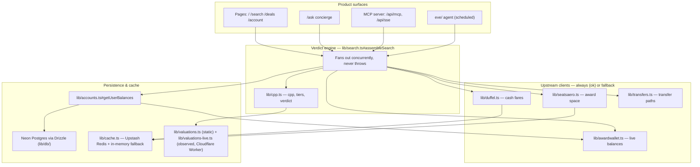

# hop

**The points-vs-cash verdict engine.** hop looks at your real airline and hotel loyalty
balances, computes the actual value of redeeming them, and tells you — in one sentence — whether
to book with points, transfer to a partner, or just pay cash.

[](https://nextjs.org)
[](https://www.typescriptlang.org)
[](#built-and-run-by-an-ai-native-team)
[](#how-it-works)


## Why this exists

Loyalty points are opaque by design, and most people mis-redeem them as a result. Every existing
tool either shows you that a seat exists, or lets an AI chatbot guess at whether it's a good
deal. Neither tells you what your points are actually worth. hop computes that number from your
real balances instead of guessing at it, and gives you a plain answer: use the points, transfer
them first, or pay cash and keep them for something better.

## How it works

Everything funnels through one function, `assembleSearch` (`lib/search.ts`). It fans out
concurrently to live cash fares (Duffel), live award availability (seats.aero), and your actual
loyalty balances (AwardWallet, plus whatever you've entered manually), then computes the
economics of every option it finds:

```
cpp = (cash price − taxes) × 100 / miles required
```

That cents-per-point number is tiered (green ≥ 3.0¢, amber ≥ 1.5¢, otherwise muted), ranked
against every other option, and reduced to one verdict — the same math a points-and-miles expert
would do by hand, computed instead of eyeballed. Two rules keep it trustworthy:

- **It always resolves, never crashes.** If an upstream source is down, that section degrades
  with a visible note instead of taking the page with it.
- **Every number is computed, never generated.** cpp, tiers, ranking, and the pick come from
  deterministic code. Even hop's AI concierge only ever narrates numbers the engine already
  computed — it never invents one.

## Built and run by an AI-native team

hop's day-to-day engineering, growth, and finance work is run largely by a standing team of
autonomous Claude Code agents — each with a name, an animal avatar, and a real cron schedule
against this actual repository. This is a genuine operating structure, not a metaphor:

| Function | Who | Runs | Does |
|---|---|---|---|
| Engineering autopilot | **Jeffrey** | Daily | Picks one unit of work — fix a broken build, rescue a stalled PR, review and merge a clean one, or advance the roadmap — and ships it end to end as a draft PR. |
| Growth | **Omar** | Mon / Wed / Fri | Owns SEO content and MCP directory listings outright, ship-and-self-merge. Drafts anything that needs a human hand on an external account rather than guessing at one. |
| Head of finance | **Elizabeth** | Tuesdays | Has her own inbox, tracks the budget envelope, hunts startup credit programs, and emails a CFO memo — but can't spend a dollar or commit to anything without an emailed yes back. |
| Weekly retro | **Bob** | Mondays | Reviews what shipped, updates the open-work playbook, and writes up any non-obvious bug fix as a permanent [`docs/solutions/`](docs/solutions/) entry so nobody debugs it twice. |
| Strategy | **Marcus** | Sundays | Runs an outside-in market and competitive scan and re-ranks what the rest of the team should work on next. |
| Project manager | **Priya** | Daily | Read-only: cross-checks Linear against actual PR activity and posts one honest status update — never touches code. |
| Merge sheriff | *(ops function)* | Hourly | Sweeps every open PR: merges what's green and safe, retries what's red, and escalates anything that needs the founder's own review instead of nagging forever. |
| Board review | *five adversarial personas* | Sundays | Reads the state of the company and produces consensus risks, contested points, a kill list, and double-downs — then checks, next time, whether its own prior amendments actually got executed. |

Why this matters more than the novelty: most "AI agent" setups reset every session — the same
class of bug gets rediscovered, the same PR stalls until a human happens to notice. Here the loop
closes without one. The merge sheriff runs hourly specifically so a green PR never just sits
there; the self-improvement loop is real, not aspirational — a bug fixed today becomes a
[`docs/solutions/`](docs/solutions/) entry so the next agent inherits the lesson automatically
instead of re-debugging it; and each board review is graded in part on whether the last one's
amendments actually landed, not just on producing a fresh critique. The volume of shipped work
compounds session over session instead of resetting.

This doesn't replace judgment where it matters. A human founder still makes every call that
touches money, identity, or anything irreversible — that's a hard rule for every desk, not a
suggestion. The agents own everything reversible: code, content, drafts, market scans, and the
numbers.

## Look under the hood

- [`docs/team/routines.md`](docs/team/routines.md) — the exact cron schedule and prompt each desk
  runs on, verbatim
- [`docs/meta/`](docs/meta/README.md) — the whole process written up as stack-agnostic patterns,
  with drop-in starter kits (Next.js/Vercel, FastAPI/Postgres, and a google3-style sketch) for
  running it on any codebase
- [`docs/board/`](docs/board/) — the board's own memos, unedited
- [hop.flights](https://hop.flights) — the live product

## What's under the hood

### Stack

- Next.js 16.2.9 (App Router) + React 19, TypeScript (strict), Tailwind CSS v4
- Neon Postgres + Drizzle ORM (`lib/db/`), Better Auth for identity (`lib/auth.ts`)
- `ai` SDK + `@anthropic-ai/sdk` for the `/ask` concierge; `mcp-handler` for the MCP server
- Duffel (cash fares), seats.aero (award space), AwardWallet (live balances), Resend (email),
  Upstash Redis (rate limiting), Stripe (billing)
- Vitest (node environment) for tests

This codebase runs on **Next.js 16.2.9 + React 19** — APIs and conventions differ from older
Next. Before writing framework code, read the relevant guide in `node_modules/next/dist/docs/`
(see `AGENTS.md`).

### Run locally

```bash
npm install
npm run dev        # http://localhost:3000
```

No upstream keys are required to see full-fidelity pages with fixture data:

```bash
npm run dev:mock    # MOCK=1 — swaps in cash/awards/balances fixtures
```

Commands:

```bash
npm run build       # also runs DB migrations + catches RSC/route errors
npm run lint
npm run typecheck
npm test
npm run check        # lint + typecheck + test — the same gate CI runs
```

Run a single test file or test by name (tests live in `lib/__tests__/` and `app/**/__tests__/`):

```bash
npx vitest run lib/__tests__/cpp.test.ts
npx vitest run -t "ranks options by cpp"
```

### Environment setup

Copy `.env.example` to `.env.local` — it's tiered and annotated in place. The top two vars
(`MOCK=1`, `UNSPLASH_ACCESS_KEY`) are enough for full-fidelity local UI work; everything else is
production functionality that's OFF by default and degrades to a clean no-op when unset:

- **Engine sources**: `DUFFEL_API_KEY_LIVE`/`DUFFEL_API_KEY_TEST`, `SEATS_AERO_API_KEY`,
  `AWARDWALLET_API_KEY` + `AWARDWALLET_USER_ID`
- **Persistence**: `DATABASE_URL` (Neon, via Drizzle) — auth is disabled until this is set
- **Identity**: `BETTER_AUTH_SECRET`, `GOOGLE_CLIENT_ID`/`GOOGLE_CLIENT_SECRET` for Google sign-in
- **AI concierge**: `AI_GATEWAY_API_KEY` (Vercel AI Gateway)
- **Email / rate limiting**: `RESEND_API_KEY`, `UPSTASH_REDIS_REST_URL`/`_TOKEN`

See `lib/env.ts` for access patterns — env reads are lazy (evaluated at call time, not import) and
every gated seam checks both a flag and its credentials before turning on.

### Project layout

- `app/` — routes, pages, API route handlers (App Router)
- `components/` — UI components and page building blocks
- `lib/` — the verdict engine, integrations, and all deterministic domain logic
- `eve/` — the Eve agent scaffold (separate runtime, not part of the Next build) — see
  [`eve/README.md`](eve/README.md)
- `docs/decisions/` — ADRs: the load-bearing architectural decisions
- `docs/solutions/` — searchable log of solved problems (grep before you debug something familiar)
- `docs/plans/` — implementation blueprints
- `docs/design/` — the design source of truth (flat editorial reference, copy voice spec)
- `docs/meta/` — the agentic dev process as portable patterns + starter kits for other repos
- `.claude/agents/` — specialized review subagents; `.claude/workflows/` — saved multi-agent
  orchestration scripts (review, plan panel, standing audit)

### Architecture



- **Balances** — `lib/accounts.ts#getUserBalances` merges manual balances (Neon) with an optional
  live AwardWallet link, de-duped by program; every surface reads through this one resolver.
- **Point valuations** — `lib/valuations.ts` is a hand-curated static baseline; `lib/valuations-live.ts`
  layers a Cloudflare Worker-aggregated, first-party-observed cpp on top once a program has ≥20
  samples (see ADR 0005).
- **Auth** — Better Auth (Google social login) on Neon via Drizzle (`lib/auth.ts`); there is no
  middleware — `app/api/auth/[...all]/route.ts` serves the auth surface and sessions resolve
  server-side per request (`lib/session.ts#getUserId`).
- **MCP server** — `app/api/[transport]/route.ts` exposes the engine (`price_trip`, `verdict`,
  `sweet_spots`, `transfer_paths`) over streamable-HTTP and SSE, authorized by optional Bearer
  `hop_` tokens.
- **AI concierge** — `/ask` is a streamed chat grounded in the user's real balances and
  destination set; it calls the same computed tools as the MCP server, never invents numbers.
- **Eve agent** — `eve/` runs the same `lib/*` engine on a schedule against real user balances and
  proactively pushes crossings (email-first); see [`eve/README.md`](eve/README.md).

### Key routes

- `/` — auth-aware home (marketing when signed out, personalized dashboard when signed in)
- `/search` (+ `/search/loading`) — the flight optimizer and verdict flow
- `/deals`, `/sweet-spots`, `/destinations` — value-oriented redemption and inspiration surfaces
- `/ask` — AI concierge
- `/book` + `/book/confirmation` — checkout (native Duffel checkout is flag-gated, off by default)
- `/account` — program and balance management
- `/api/[transport]` — MCP server (`/api/mcp`, `/api/sse`)

### Cron jobs

Ten jobs defined in `vercel.json`, all guarded by `CRON_SECRET`: standing-order sweeps (every 6h),
AwardWallet balance sync (every 6h), weekly SEO revalidation, daily valuation sync, daily balance
autosync, daily sweet-spot candidate generation, daily Stripe sync, a weekly newsletter digest, a
weekly business digest, and a daily health sentinel.

## Documentation & how we work here

This repo is **agent-native**: every unit of work should make the next one easier (the compound
engineering loop — Plan → Work → Review → Compound — is detailed in `AGENTS.md`;
smaller/less-capable models should read `docs/agent-playbook.md` first).

- `AGENTS.md` (imported by `CLAUDE.md` for Claude Code) — the always-loaded operating rules for this repo
- `docs/README.md` — index of product/design/planning docs
- `docs/decisions/` — ADRs (read the relevant one before changing a decided area)
- `docs/solutions/` — searchable solved-problems log (grep before solving something familiar)
- `docs/design/copy-spec.md` — strict UI copy voice
- `.claude/workflows/README.md` — the saved multi-agent review/plan/audit scripts and their
  manual-fallback equivalents in `.claude/commands/`
- `docs/team/routines.md` — the standing autonomous agent org (canonical over claude.ai config)
- `docs/board/` — weekly independent business/execution reviews + adopted amendments

## Notes for contributors

- The verdict engine is deterministic — rankings and recommendations are computed, not generated.
- Graceful degradation is the house style: `lib/*` clients and DB helpers
  (`lib/supabase-helpers.ts#withDb`) return `{ok:false}`/fallbacks and never throw; a dead upstream
  degrades a section instead of crashing the page.
- New seams ship flag-gated (`lib/env.ts`) and degrade to a clean no-op when unconfigured.
- For framework-specific behavior, consult `node_modules/next/dist/docs/` before changing route
  handlers, metadata, caching, server actions, or `params`/`searchParams` usage — don't assume
  training-data Next.js behavior.
- Keep design and copy updates aligned with `docs/design/`.
